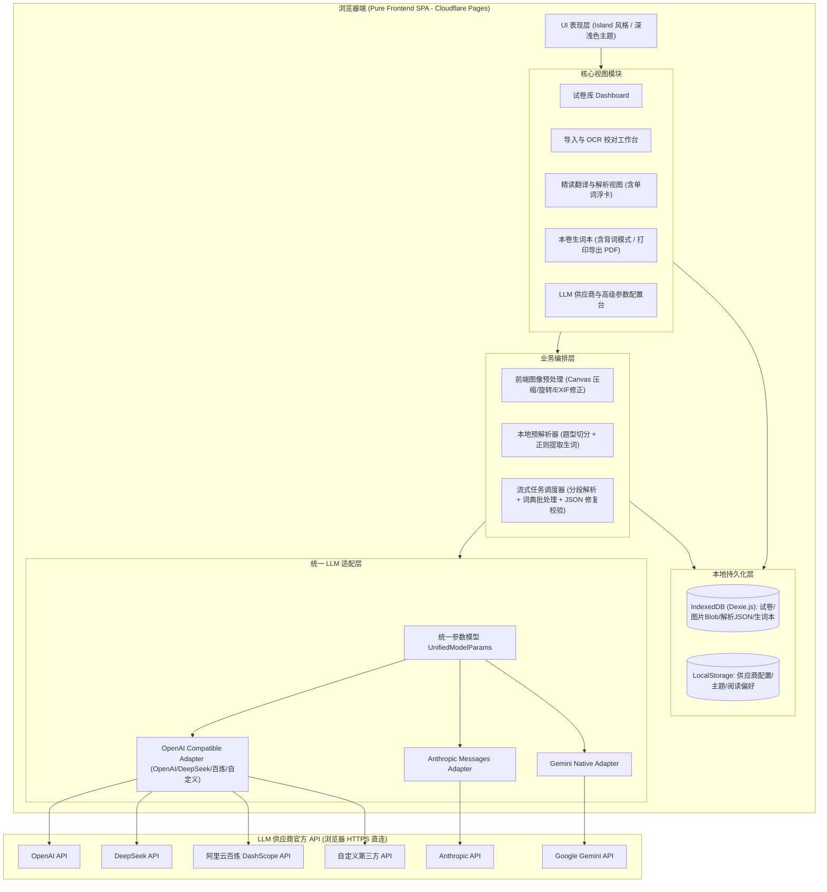
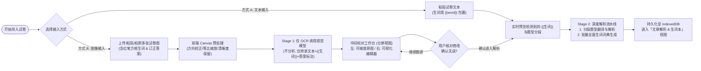

# Studying-Mate（考研英语 AI 精读与解析助手）完整架构设计文档

> **文档版本**：v1.4（新增新题型四子类全适配、AI 自动总结/补充生词模式、光标处精准插入分题标签、PDF 打印防跨页截断架构、WebDAV 备份/双向同步与基于 Web Crypto AES-256-GCM 的 API Key 端到端加密同步）  
> **日期**：2026-11-25  
> **部署目标**：Cloudflare Pages（纯前端静态站点）  
> **生产域名**：`https://studingmate.wanderflare.net`  
> **开发环境**：WSL2（Node.js `v24.18.0` / `pnpm`）+ Vite Dev Server（`http://localhost:5173`）

---

## 目录

1. [项目愿景与总体架构](#1-项目愿景与总体架构)
2. [技术栈选型与部署架构](#2-技术栈选型与部署架构)
3. [浏览器 CORS 跨域实测与纯前端直连可行性报告](#3-浏览器-cors-跨域实测与纯前端直连可行性报告)
4. [多供应商 LLM 抽象层与详细参数体系设计](#4-多供应商-llm-抽象层与详细参数体系设计)
5. [核心业务流程：双模输入与 OCR 中间校对态](#5-核心业务流程双模输入与-ocr-中间校对态)
6. [考研英语题型解析与生词本功能设计](#6-考研英语题型解析与生词本功能设计)
7. [Prompt 工程与结构化 JSON 数据模型设计](#7-prompt-工程与结构化-json-数据模型设计)
8. [UI / UX 设计规范（现代 Island 风格与深浅色适配）](#8-ui--ux-设计规范现代-island-风格与深浅色适配)
9. [本地数据持久化与安全隐私策略](#9-本地数据持久化与安全隐私策略)
10. [目录结构与分阶段实施路线图](#10-目录结构与分阶段实施路线图)

---

## 1. 项目愿景与总体架构

**Studying-Mate** 是一款面向考研英语（英语一 / 英语二）备考场景的 **BYOK（Bring Your Own Key）纯前端 Web 应用**。用户自行配置 LLM 供应商与模型参数，通过文本粘贴或拍照上传试卷，完成「红笔生词识别 → 人工校对 → 分题型深度解析与双语翻译 → 交互式生词卡片与可打印生词本」的完整精读闭环。

### 1.1 核心设计原则

- **纯前端零后端依赖（Local-First & Zero-Backend）**：所有数据（试卷原文、图片缩略图、解析结果、生词本、API Key）存储在浏览器本地（IndexedDB / LocalStorage），网络请求由浏览器直连各 LLM 供应商官方接口，零服务器运维成本，彻底规避隐私集中托管风险。
- **两阶段流水线（OCR 校对态解耦）**：图像输入严格拆分为「Stage 1：纯 OCR 识图 + 红框生词/订正答案标注」与「Stage 2：纯文本结构化解析」，在中间插入人工校对工作台，避免视觉识别误差直接污染后续精读解析。
- **统一底层参数 + 供应商特化适配**：预设供应商（DeepSeek、阿里云百炼、OpenAI、Anthropic、Google Gemini）与用户自定义供应商共用一套统一的参数模型，由 Protocol Adapter 屏蔽各家协议差异（思考模式参数、视觉 Base64 格式、CORS 专用 Header、结构化输出约束）。
- **防截断的分段编排解析**：面对整套考研真题（输出可达 15K–30K Token），前端自动按题型/篇目切分并提取 `{{生词}}`，分段并发/串行流式请求 + 批量生成全面词典释义，既保证 JSON 稳定性，又实现「边解析边阅读」。

### 1.2 系统总体架构图



---

## 2. 技术栈选型与部署架构

结合本地环境（WSL2 + Node `v24.18.0` + `pnpm`）与最终部署平台（Cloudflare Pages），选择轻量、生态成熟、构建产物为纯静态文件的现代前端栈：

| 层次 | 选型 | 版本/方案 | 选型理由 |
| :--- | :--- | :--- | :--- |
| **构建工具** | **Vite** | Vite 6 + TypeScript 5 | 极速冷启动与 HMR（默认端口 `5173`），产物为标准静态 SPA，与 Cloudflare Pages 天生契合 |
| **UI 框架** | **React** | React 19 | 生态完善，适合富文本高亮交互（生词划线、浮卡定位、分屏校对、句子成分树渲染） |
| **样式方案** | **Tailwind CSS** | Tailwind CSS v4 | 原子化 + CSS 变量主题令牌，原生支持 `dark:` 变体与 `@media print` 精准打印排版 |
| **基础组件** | **Radix UI** + **Floating UI** | Headless Primitives | 无障碍、精准锚点定位（点击生词弹出小卡片自动避让视口边缘，不引入笨重组件库风格） |
| **图标库** | **Lucide React** | 线性极简图标 | 线条克制，契合 Island 现代极简审美 |
| **状态管理** | **Zustand** | 轻量响应式状态 | 管理全局配置、当前分析任务进度、阅读模式设置，无冗余样板代码 |
| **本地数据库** | **Dexie.js** | IndexedDB 封装 | 轻松存储上百套试卷 JSON、高清原图 Blob（支持离线查阅）、生词本索引查询 |
| **数据校验** | **Zod** + **jsonrepair** | 运行时 Schema 校验 | 强校验 LLM 返回 JSON 结构；结合 `jsonrepair` 自动修复偶发尾逗号/截断括号 |
| **PDF 导出** | **原生 `@media print`** | 浏览器矢量打印引擎 | 零体积依赖、中英文字体高清矢量可选中复制、精准 A4 分页，远优于 `html2canvas` 截图方案 |
| **音频朗读** | **Web Speech API** | 浏览器内置 TTS | 单词卡片内一键英音/美音朗读，完全离线免 API |
| **包管理器** | **pnpm** | 本地已安装 | 依赖安装快、磁盘占用低 |

### Cloudflare Pages 部署配置

- **构建命令**：`pnpm build`
- **输出目录**：`dist`
- **SPA 路由回退**：在 `public/_redirects` 中配置 `/* /index.html 200`，保证 `/paper/:id` 等前端路由刷新不报 404。
- **自定义域名**：绑定 `studingmate.wanderflare.net`，开启自动 HTTPS 与 Brotli 压缩。

---

## 3. 浏览器 CORS 跨域实测与纯前端直连可行性报告

> **实测结论先行**：五大预设供应商（OpenAI、Anthropic、Google Gemini、DeepSeek、阿里云百炼）在**开发环境（`http://localhost:5173`）**与**生产环境（`https://studingmate.wanderflare.net`）**下，**全部通过** `OPTIONS` 预检请求，**纯前端浏览器直连完全可行，无需搭建后端！**

### 3.1 官方文档态度 vs 实际网络行为差异

许多官方教程出于「避免在面向公众的网站硬编码开发者自己的 API Key」的安全考虑，会笼统建议「不要在前端直接调用」。但本项目属于 **BYOK（用户自填 Key、仅本地浏览器存储）** 模式，API Key 仅在用户自己的浏览器与供应商服务器之间直传，因此只受限于供应商服务端是否下发合法的 CORS 响应头。

### 3.2 `curl -X OPTIONS` 实测结果汇总（2026-11-22 实测）

针对两个目标 Origin 模拟浏览器预检请求：
- **Dev Origin**：`http://localhost:5173`
- **Prod Origin**：`https://studingmate.wanderflare.net`

| 供应商 | 测试端点 (Endpoint) | Dev (`localhost:5173`) 预检结果 | Prod (`studingmate.wanderflare.net`) 预检结果 | 放行方法 & 请求头 | 浏览器直连特殊注意事项 |
| :--- | :--- | :--- | :--- | :--- | :--- |
| **OpenAI** | `https://api.openai.com/v1/chat/completions`<br>`https://api.openai.com/v1/responses` | **PASS (`HTTP/2 200`)**<br>回显 `ACAO: http://localhost:5173` | **PASS (`HTTP/2 200`)**<br>回显 `ACAO: https://studingmate.wanderflare.net`（Responses 返回 `*`） | `GET, OPTIONS, POST`<br>`content-type, authorization` | 建议直接使用原生 `fetch` 发起请求（若用官方 JS SDK 需开启 `dangerouslyAllowBrowser: true`） |
| **Anthropic** | `https://api.anthropic.com/v1/messages` | **PASS (`HTTP/2 200`)**<br>`ACAO: *` | **PASS (`HTTP/2 200`)**<br>`ACAO: *` | `POST, GET, ...`<br>`content-type, x-api-key, anthropic-version, anthropic-dangerous-direct-browser-access` | **关键坑点**：① POST 请求头**必须**携带 `anthropic-dangerous-direct-browser-access: true`，否则业务层拒收；② `fetch` **必须**保持 `credentials: 'omit'`（因响应同时带 `ACAO: *` 与 `ACAC: true`，若携带凭证会被浏览器拦截） |
| **Google Gemini** | `https://generativelanguage.googleapis.com/v1beta/models/{m}:generateContent`<br>`.../v1beta/openai/chat/completions` | **PASS (`HTTP/2 200`)**<br>回显 `ACAO: http://localhost:5173` | **PASS (`HTTP/2 200`)**<br>回显 `ACAO: https://studingmate.wanderflare.net` | `POST, GET, ...`<br>`content-type, x-goog-api-key` / `authorization` | 原生接口与 OpenAI 兼容接口均完美放行；**推荐走原生接口**以完整支持 `thinkingConfig`、`inline_data` 与 `responseSchema` |
| **DeepSeek** | `https://api.deepseek.com/chat/completions` | **PASS (`HTTP/2 200`)**<br>回显 `ACAO: http://localhost:5173` | **PASS (`HTTP/2 200`)**<br>回显 `ACAO: https://studingmate.wanderflare.net` | `POST`<br>`content-type, authorization` | 对话接口仅声明放行 `POST`；**旧模型 ID `deepseek-chat` / `deepseek-reasoner` 已退役**，现主力为 `deepseek-flash`（原生支持图像输入）与 `deepseek-v4-pro` |
| **阿里云百炼 (Model Studio)** | 专属域名：`https://{WorkspaceId}.{region}.maas.aliyuncs.com/compatible-mode/v1`<br>兼容旧域：`https://dashscope.aliyuncs.com/compatible-mode/v1` | **PASS (`HTTP/2 200`)**<br>通用域 `ACAO: *` | **PASS (`HTTP/2 200`)**<br>通用域 `ACAO: *` / 国际回显准确 Origin | `POST, GET`<br>`content-type, authorization` | **重要**：阿里云百炼现要求按账号/业务空间配置专属域名 `{WorkspaceId}.{region}.maas.aliyuncs.com`（每人不同），UI 须由用户填写 WorkspaceId + 地域或完整 Base URL，并校验 API Key 与空间匹配 |

### 3.3 自定义供应商的 CORS 兜底设计（可选扩展）

虽然 5 大主流官方供应商均已实测支持直连，但用户未来可能会添加**自建 Ollama/vLLM** 或**未配置 CORS 头的第三方中转站**。为此在架构中预留清晰的降级提示与可选方案：

1. **默认模式（100% 纯前端直连）**：所有请求直接由浏览器发出，不经过任何中间服务器。
2. **CORS 错误智能诊断**：当 `fetch` 抛出 `TypeError: Failed to fetch` 时，UI 明确提示「可能遇到目标服务器 CORS 跨域拦截或网络不可达」，并给出解决建议（例如本地 Ollama 需设置环境变量 `OLLAMA_ORIGINS="https://studingmate.wanderflare.net,http://localhost:5173"`）。
3. **可选自定义代理地址（User-Supplied Proxy）**：每个自定义供应商允许填写 `Base URL`（用户可自行填自己的 Cloudflare Worker 反代地址）。如后续确实有强烈需求，Cloudflare Pages 本身也支持零运维的同域 Pages Function（`functions/api/proxy.ts`，仅限本站点 Origin 调用、不记录日志、默认关闭、由用户按需勾选），但 **v1.0 坚持零后端纯静态交付**。

---

## 4. 多供应商 LLM 抽象层与详细参数体系设计

参考主流 AI Agent 与桌面客户端（Cline、Roo Code、Cherry Studio、LobeChat、Vercel AI SDK）的成熟架构，采用 **「协议层（Protocol）与供应商预设层（Provider Preset）解耦」** 的设计，确保预设与自定义供应商共享同一套底层参数模型与 UI 表单。

### 4.1 架构分层：双槽位模型路由 + 统一参数模型

考研场景存在一个典型痛点：用户可能希望用旗舰纯文本推理模型（如 `deepseek-v4-pro`）做深度解析，但上传试卷照片时需要视觉模型（如 `deepseek-flash`、`qwen3-vl-plus`、`gemini-2.5-flash` 或 `gpt-5`）做 OCR；而使用 `deepseek-flash` / `gpt-5` / `claude-sonnet-5-5` / `gemini` 时，单模型即可同时胜任图文 OCR 与文本分析。

因此引入 **双任务槽位路由（Task Model Routing）**：
- **主分析模型槽位（Analysis Model）**：负责文本解析、翻译、句子结构分析、生词释义。
- **视觉 OCR 模型槽位（Vision / OCR Model）**：负责图片试卷 OCR 与红框识别；默认「跟随主模型」，当主模型不支持视觉（`capabilities.vision === false`，例如 `deepseek-v4-pro`）时自动阻止误发并引导切换至视觉槽位（可同供应商切换如 `deepseek-flash`，也可跨供应商混搭如「阿里云 `qwen3-vl-plus` 识图 + `deepseek-v4-pro` 深度解析」）。

### 4.2 统一底层参数模型（`UnifiedModelParams`）

所有预设供应商与自定义供应商底层共用同一份 TypeScript 类型定义：

```typescript
export type ApiProtocol =
  | 'openai-compatible'   // OpenAI Chat Completions / DeepSeek / 阿里云百炼 / 绝大多数中转与本地模型
  | 'openai-responses'    // OpenAI Responses API (/v1/responses)
  | 'anthropic-messages'  // Anthropic Messages API (/v1/messages)
  | 'gemini-native';      // Google Gemini Native API (:generateContent / :streamGenerateContent)

export type ThinkingMode =
  | 'none'      // 模型不支持思考
  | 'toggle'    // 开关型（如 DeepSeek thinking.type / 百炼 enable_thinking）
  | 'effort'    // 档位型（如 DeepSeek reasoning_effort / OpenAI reasoning_effort / Claude 5 output_config.effort / Gemini 3-4 thinkingLevel）
  | 'budget';   // Token 预算型（如百炼 thinking_budget / Anthropic 旧版 budget_tokens / Gemini 2.5 thinkingBudget）

export type ReasoningEffort = 'none' | 'minimal' | 'low' | 'medium' | 'high' | 'xhigh' | 'max';

export interface ModelCapabilities {
  vision: boolean;                     // 是否支持图像输入（不支持时前端阻断发图避免 400）
  thinking: ThinkingMode[];            // 支持的思考控制方式
  supportedEfforts?: ReasoningEffort[];// 该模型严格合法的档位枚举（UI 仅展示支持项，避免传错报 400）
  alwaysOnThinking?: boolean;          // 是否为强制开启思考的模型（如部分 Claude 5 旗舰，关闭会报 400）
  structuredOutput: ('json_schema' | 'json_object' | 'prompt_only')[];
  supportsTopK: boolean;
  supportsFrequencyPenalty: boolean;
  supportsPresencePenalty: boolean;
  supportsSeed: boolean;
  disableSamplingWhenThinking: boolean; // 开启思考时自动省略 temperature/top_p 等采样参数
  streamRequiredWhenThinking: boolean;  // 开启思考时强制 stream=true（如百炼思考模型）
}

export interface UnifiedModelParams {
  // 1. 上下文与 Token 预算控制
  contextWindow: number;               // 模型总上下文窗口（用于前端 Token 估算与超限预警）
  maxInputTokens: number;              // 前端允许的最大输入 Token 上限（软保护阈值）
  maxOutputTokens: number;             // 单次请求最大输出 Token（含思考 Token 的模型会注明）
  
  // 2. 深度思考 / 推理控制（参考主流 Agent 参数设计）
  thinking: {
    enabled: boolean;                  // 是否开启思考模式
    effort?: ReasoningEffort;          // 推理强度档位（effort 模式生效）
    budgetTokens?: number;             // 思考 Token 预算上限（budget 模式生效；Gemini 2.5 支持 -1 动态）
    includeThoughts: boolean;          // 是否在 UI 中流式展示可折叠的思考过程
  };

  // 3. 采样控制（null 表示「使用供应商默认值，不发送该字段」）
  temperature?: number | null;         // 范围 0.0 ~ 2.0（解析任务建议 0.1 ~ 0.3 提升稳定度）
  topP?: number | null;                // 范围 0.0 ~ 1.0
  topK?: number | null;                // 整数（仅 Gemini / Anthropic / 百炼支持）
  frequencyPenalty?: number | null;    // -2.0 ~ 2.0（OpenAI / DeepSeek / 百炼）
  presencePenalty?: number | null;     // -2.0 ~ 2.0（OpenAI / DeepSeek / 百炼）
  seed?: number | null;                // 随机种子（可选）
  stopSequences?: string[];            // 停止词列表

  // 4. 传输、格式与多模态控制
  stream: boolean;                     // 默认 true：防长文本超时 + 实时展示进度与思考链
  structuredOutputMode: 'auto' | 'json_schema' | 'json_object' | 'prompt_only';
  imageDetail: 'auto' | 'low' | 'high'; // 视觉清晰度（OCR 试卷强烈建议默认 high）
  timeoutMs: number;                   // 单次请求超时时间（默认 180000ms，思考模型可调大）
  maxRetries: number;                  // 网络抖动自动重试次数（默认 2）

  // 5. 高级透传（供自定义供应商或新特性尝鲜）
  customHeaders?: Record<string, string>;
  extraBody?: Record<string, unknown>; // 合并到请求体顶层的扩展 JSON 字段
}

export interface ProviderProfile {
  id: string;                          // 'deepseek' | 'dashscope' | 'openai' | 'anthropic' | 'gemini' | custom uuid
  presetKey: 'deepseek' | 'dashscope' | 'openai' | 'anthropic' | 'gemini' | 'custom';
  name: string;                        // 显示名称
  protocol: ApiProtocol;
  baseUrl: string;                     // 阿里云百炼需由用户配置专属域名 https://{WorkspaceId}.{region}.maas.aliyuncs.com/compatible-mode/v1
  workspaceMeta?: {                    // 阿里云百炼专属辅助字段（自动拼接 Base URL，亦允许手改）
    workspaceId?: string;
    region?: string;                   // 如 cn-beijing / cn-shanghai / ap-southeast-1 / us-east-1
  };
  apiKey: string;
  modelId: string;                     // 当前选定模型 ID
  capabilities: ModelCapabilities;
  params: UnifiedModelParams;
}
```

### 4.3 五大预设供应商默认参数与特化映射矩阵

底层 `ProviderAdapter` 根据 `presetKey`、`protocol` 与当前 `modelId` 将同一套 `UnifiedModelParams` 精准翻译为各供应商原生请求体：

| 预设供应商 | Base URL 与协议 | 现行主力模型 ID（含视觉能力标注） | 上下文 / 最大输出默认上限 | 图像输入 (Vision) API 差异 | 协议特殊处理 |
| :--- | :--- | :--- | :--- | :--- | :--- |
| **DeepSeek** | 默认 `https://api.deepseek.com`<br>`openai-compatible` | **`deepseek-flash`**（主力推荐，**原生支持视觉 + 思考**，底层 `DeepSeek-V4.1-Flash`，别名 `deepseek-v4-flash`）<br>**`deepseek-v4-pro`**（旗舰纯文本深度推理，**不支持视觉**）<br>*(注：`deepseek-chat` / `deepseek-reasoner` 已官方退役)* | 上下文：`1,000,000`<br>最大输出：非思考默认 `8,192` / 思考默认 `65,536`（上限 `384K`） | `deepseek-flash` 使用标准 OpenAI `image_url: { url: "data:image/jpeg;base64,...", detail }`；向 `deepseek-v4-pro` 传图会直接报 `400 This model does not support image.`，前端提前拦截提示 | 流式思考内容在 `delta.reasoning_content`；支持 `response_format: { type: "json_object" }` |
| **阿里云百炼 (Model Studio)** | **用户必填业务空间专属域名**：`https://{WorkspaceId}.{region}.maas.aliyuncs.com/compatible-mode/v1`<br>*(UI 提供 `WorkspaceId` + 地域下拉自动拼接器，同时允许直接粘贴完整 URL 或兼容旧域 `dashscope.aliyuncs.com`)*<br>`openai-compatible` | 文本/混合思考：`qwen3.8-max` / `qwen3.7-plus` / `qwen-plus` / `qwen4-max`<br>视觉多模态：**`qwen3-vl-plus`** / **`qwen-vl-max`** | 文本上下文：`1,000,000`，最大输出 `65,536`<br>VL 上下文：`262,144`，最大输出 `32,768` | `qwen3-vl-plus` 等视觉模型使用 OpenAI 兼容 `image_url: { url: "data:image/jpeg;base64,..." }` | **API Key 与业务空间+地域强绑定**（不匹配报 401/403）；流式思考在 `delta.reasoning_content`；建议 `stream_options: { include_usage: true }` |
| **OpenAI** | 默认 `https://api.openai.com/v1`<br>`openai-compatible`（可选 `openai-responses`） | **`gpt-5`** / **`o4-mini`** / **`o3`** / **`gpt-4.1`**（均支持视觉） | `gpt-5` 上下文 `400,000` / `gpt-4.1` 上下文 `1,000,000`<br>最大输出默认 `16,384`（最高 `128K`） | `image_url: { url: "data:image/jpeg;base64,...", detail: "high" }`（Responses API 为 `input_image`） | 最大输出字段在 Chat Completions 用 `max_completion_tokens`（Responses API 用 `max_output_tokens`）；优先启用 `response_format: { type: "json_schema", strict: true }` |
| **Anthropic (Claude)** | 默认 `https://api.anthropic.com`<br>`anthropic-messages` | **`claude-sonnet-5-5`** / **`claude-opus-5-5`** / **`claude-haiku-5-5`** / `claude-fable-5-2`（均支持视觉） | 上下文：`1,000,000`<br>最大输出：`128,000`（默认 `16,384`） | **`type: "image"` 独立块**：`source: { type: "base64", media_type: "image/jpeg", data: "<纯Base64，无data:前缀>" }` | **必带请求头**：`anthropic-version: 2023-06-01`、`x-api-key`、`anthropic-dangerous-direct-browser-access: true`；`system` 为独立顶层字段 |
| **Google Gemini** | 默认 `https://generativelanguage.googleapis.com`<br>`gemini-native` | **`gemini-4-argon`** / **`gemini-4-carbon`** / **`gemini-2.5-pro`** / **`gemini-2.5-flash`**（均原生支持视觉） | 上下文：`1,048,576`<br>最大输出：`65,536`（默认 `16,384`） | **`inline_data` 块**：`{ inline_data: { mime_type: "image/jpeg", data: "<纯Base64，无data:前缀>" } }` | 端点 `:streamGenerateContent?alt=sse`，鉴权走请求头 `x-goog-api-key`；原生支持 `responseMimeType: "application/json"` + `responseSchema` |
| **自定义供应商 (Custom)** | 用户自填 Base URL<br>任选 4 种协议之一 | 用户自填 Model ID | 默认 `128,000` / `8,192`（可任意修改） | 按所选协议自动套用 Base64 编码规范 | 支持自定义 HTTP Headers、任意 `extraBody` JSON 与一键连通性测试 |

### 4.4 各供应商「思考/推理参数」精确规范与不兼容行为矩阵（核心防 400 指南）

各家对思考参数的字段名、档位枚举、以及传入不兼容参数时的服务端行为差异极大——**多数厂商并非自动降级兼容，而是直接返回 `HTTP 400 Bad Request`**。前端适配器必须严格按此表做精确映射与发前拦截：

| 供应商 | 精确参数名称与结构 | 支持的深度 / 档位枚举 | 不兼容参数的厂商真实行为（自动适配 vs 直接报错） | 本项目适配器策略 |
| :--- | :--- | :--- | :--- | :--- |
| **DeepSeek** | Chat Completions 顶层：`thinking: { type: "enabled" \| "disabled" }` + `reasoning_effort` | `reasoning_effort`: `"none"` / `"low"` / `"high"` / `"max"`（`"none"` 等价关闭思考） | ① 传 `"medium"` 时服务端**自动路由映射**为 `"high"`；<br>② 思考模式下传 `temperature` / `presence_penalty` / `frequency_penalty` **不报错，但静默忽略不生效**；<br>③ 纯文本模型 `deepseek-v4-pro` 传图 → **直接报 400**；<br>④ 多轮思考对话漏传 `reasoning_content` → **直接报 400** | 关闭思考时发 `thinking: { type: "disabled" }` 与 `reasoning_effort: "none"`；开启时省略采样参数，仅允许合法 4 档（`low/high/max`） |
| **阿里云百炼 (Model Studio)** | REST JSON 顶层（非 SDK 嵌套 `extra_body`）：`enable_thinking: boolean` + `thinking_budget: integer` | 无字符串档位，通过正整数 `thinking_budget` 控制思维链最大 Token（如 `4096` / `16384` / `32768`，不超过模型上限） | ① 思考模式下设 `stream: false` → **直接报 400**（部分高阶模型强制流式）；<br>② `thinking_budget <= 0` 或超模型上限 → **直接报 400**；<br>③ 业务空间域名与 API Key 不匹配 → **直接报 401/403** | 开启 `enable_thinking: true` 时强制 `stream: true` 且校验 `thinking_budget` 为正整数；关闭时显式发 `enable_thinking: false` 且不发 `thinking_budget` |
| **OpenAI** | Chat Completions：顶层 `reasoning_effort`<br>Responses API：嵌套 `reasoning: { effort }` | 视具体模型支持：`"none"` / `"minimal"` / `"low"` / `"medium"` / `"high"` / `"xhigh"` / `"max"`（如 `o3`/`o4-mini` 为 `low`/`medium`/`high`；`gpt-5` 含 `none`/`minimal` 等） | **严格直接报 400！**<br>① 向 `/v1/responses` 传 `reasoning_effort` → **400**；<br>② 推理模型传旧字段 `max_tokens` 或传 `temperature`/`top_p` → **400**；<br>③ 传该模型不支持的 effort 字符串 → **400** | 按协议严格区分 `reasoning_effort` vs `reasoning.effort`；推理模型自动用 `max_completion_tokens` 且剥离 `temperature`/`top_p` |
| **Anthropic (Claude)** | **Claude 5.x**：`thinking: { type: "adaptive" }` + `output_config: { effort }`<br>**旧版 Claude 3.7/4.x**：`thinking: { type: "enabled", budget_tokens }` | Claude 5.x `effort`：`"low"` / `"medium"` / `"high"` / `"xhigh"` / `"max"`；<br>旧版 `budget_tokens`：整数 `>= 1024` 且 `< max_tokens` | **严格直接报 400！**<br>① 对 Claude 5.x 传旧版 `thinking: { type: "enabled", budget_tokens }` → **400**；<br>② 对强制开启思考的旗舰（如 Opus 5.5）传 `disabled` 或在关闭思考时传 `xhigh`/`max` → **400**；<br>③ 思考模式下传 `temperature`/`top_p` 或 `max_tokens <= budget_tokens` → **400**；<br>④ 浏览器漏传 `anthropic-dangerous-direct-browser-access: true` → **401/400** | 按模型版本自动切换 Adaptive (`output_config.effort`) vs Manual (`budget_tokens`)；开启思考自动剥离采样参数并强制校验 `max_tokens > budget_tokens` |
| **Google Gemini** | `generationConfig.thinkingConfig`:<br>**Gemini 3/4**：`thinkingLevel` + `includeThoughts`<br>**Gemini 2.5**：`thinkingBudget` + `includeThoughts` | Gemini 3/4：`thinkingLevel` 为 `"LOW"` / `"MEDIUM"` / `"HIGH"` / `"XHIGH"`；<br>Gemini 2.5：`thinkingBudget` 为 `-1`（动态）/ `0`（关闭，仅 Flash 系列）/ 正整数 | **严格直接报 400！**<br>① 同时传 `thinkingLevel` 与 `thinkingBudget` → **400**（`not supported together`）；<br>② 对 Gemini 4 传旧版 `thinkingBudget` → **400**；<br>③ 对不允许关闭思考的 Pro 模型传 `thinkingBudget: 0` → **400** | 根据模型前缀（`gemini-4*`/`gemini-3*` vs `gemini-2.5*`）互斥注入对应字段，绝不同时发送 |

### 4.5 主流 Agent 级执行态展示与透明错误诊断（Observability & Diagnostics）

参考 Cline、OpenCode、Cherry Studio、LobeChat 等主流 Agent 客户端的透明化交互，本项目绝不向用户呈现「转圈黑盒」或模糊的「请求失败」提示：

1. **结构化执行步骤时间线（Execution Step Panel）**：
   - 在 OCR 识图与深度解析过程中，以清晰的可折叠 Island 面板实时展示流水线每一步的状态（如 `本地生词提取 (42词)` → `完形填空解析` → `Text 1 解析` → `生词本第 1 批 (1-20)`），标注耗时、首字延迟（TTFT）与实时 Token 统计（输入 / 思考 / 输出）。
2. **可折叠模型思考过程（Live Thinking Accordion）**：
   - 当用户开启 `thinking.includeThoughts` 且模型返回思考流（DeepSeek/百炼 `reasoning_content`、Anthropic `thinking` block、Gemini `thought: true` part）时，在当前步骤卡片下展示**实时滚动的思考过程折叠区**（柔和等宽/浅灰排布，不抢主视图视觉），步骤完成后自动收起，用户随时可点开复盘模型的推理依据。
   - 若未来扩展前端本地步骤（如图像压缩、题型切分、JSON 自动修复），同样以轻量「处理动作徽章」形式透明展示，类似 Agent 的 Tool Call 卡片。
3. **完整错误诊断卡片（Transparent Error Inspector）**：
   - 任何 API 请求失败（4xx/5xx、CORS 拦截、超时、JSON 校验失败）必须捕获并结构化展示**完整失败上下文**：
     - **错误类型与状态码**：如 `HTTP 400 Bad Request`、`HTTP 401 Unauthorized`、`NETWORK / CORS BLOCKED`、`JSON_SCHEMA_ERROR`
     - **请求上下文**：目标 Endpoint URL（脱敏 Key）、所用 Model ID、服务端返回的 `Request ID`（`x-request-id` / `cf-ray`）
     - **结构化错误摘要**：提取供应商返回的 `error.message`、`error.type`、`error.code`、`error.param`，并给出中文排查建议（例如遇到阿里云 401 提示核对业务空间域名与 API Key 是否匹配，遇到 DeepSeek 400 提示是否误用纯文本模型传图）
     - **原始返回体展开框（Raw Response Body）**：完整保留供应商返回的原始 JSON / 文本（支持一键复制完整错误报告 + 单步骤一键重试）。

### 4.6 参数校验与防呆机制

1. **实时 Token 估算器**：前端集成轻量估算器（英文按 ~4 chars/token、中文按 ~1.5 chars/token、图片按分辨率 tile 估算），在「开始分析」按钮旁展示 `预计输入 / contextWindow` 进度条，超出 `maxInputTokens` 时柔和预警并建议分段解析。
2. **参数互斥自动联动**：例如开启思考模式且当前模型满足 `disableSamplingWhenThinking: true` 时，`temperature` 与 `top_p` 自动置灰并注明原因；选择阿里云百炼未填写业务空间专属域名时高亮提示。
3. **一键连通性测试（Test Connection）**：配置页面提供「测试连接」按钮，发送最小 Token 探测请求，展示 CORS 放行状态、鉴权结果、首字延迟（TTFT），**失败时直接弹出完整错误诊断卡片显示供应商原始返回内容**。

---

## 5. 核心业务流程：双模输入与 OCR 中间校对态

### 5.1 端到端用户工作流



### 5.2 前端图像预处理策略与 DeepSeek 图像传输限额防呆（针对红笔方框优化）

拍照上传的考研真题照片（如 iPhone HEIC 转 PNG）单张体积往往高达 **10MB–20MB**，直接转 Base64 不仅请求体暴涨、消耗大量视觉 Token，还极易触发供应商请求体上限。本项目统一采用 **「前端 Canvas 智能 JPEG 压缩 + Base64 Data URL 直传」**（默认不走 Files API `file_id`，避免纯前端额外上传往返、服务端残留文件清理与潜在的 `/files` 跨域问题）：

- **长边与分辨率约束**：默认等比缩放到长边 `<= 2048px`（足够看清小号印刷体与手写红框；远低于 DeepSeek 规定的单边 `8192px` 及 `>=15张` 时降为 `4096px` 的上限）。
- **编码与体积自适应压缩**：输出 `image/jpeg`（初始 quality `0.86`），**严禁转灰度图**（必须完整保留红色通道以识别红笔方框与红笔订正！）。实测 15MB 手机 PNG 可压缩至 **300KB–700KB**；若单张压缩后仍超过安全阈值（默认 `4 MiB`），前端自动逐级微调 JPEG 质量（最低 `0.72`）确保体积可控，并在导入页直观展示 `原始大小 → 压缩后大小`。
- **DeepSeek 官方多图限额硬校验（发前防呆）**：
  - 请求体总大小上限：`48 MiB`（前端按 Base64 实际字节数自动分批打包，单批严格控制在安全预算内，默认每批 `2` 页并发/串行 OCR 以兼顾准确率与速度）。
  - 单张 Base64 图片文件上限：`32 MiB`（前端发前硬校验，超限则清晰报错提示）。
  - 单次请求最大图片数：`600` 张；单次请求图片总大小（非 `file_id`）：`<= 64 MiB`；当单次请求包含 `>= 15` 张图片时，尺寸安全检查自动按单边 `<= 4096px` 约束。
- **多图重排与增量 OCR**：支持单次上传多页真题照片（拖拽排序、前移/后移、顺时针 90° 旋转、删除单页、剪贴板 Ctrl+V 粘贴），按页码顺序分批 OCR 后自动拼接；支持在已有稿件上**继续追加新照片并仅对新增页做增量 OCR**（不重复识别已识别页）。
- **OCR 后图片不持久化策略**：上传的图片仅在浏览器当前会话内存中用于预览、重排与 OCR 校对；一旦完成 OCR 并进入解析/保存，**不再将图片 Blob 持久化到 IndexedDB**（同时清理历史遗留关联图片），彻底释放本地存储空间。

### 5.3 OCR 中间校对、光标处插入分段标记与增量编辑工作台

OCR 完成后或复用已有试卷原文进入 `/import?paperId=<id>` 时，工作台提供完整的「校对 → 分段边界标记 → 生词策略选择 → 增量解析」闭环：

1. **左右分屏布局（移动端上下切换）**：
   - **左侧岛卡片**：高清原图查看器（仅当前会话带图时展示），支持滚轮缩放、拖拽平移、页面缩略图切换，方便对照检查红框是否漏识。
   - **右侧岛卡片**：带快捷标记工具栏的纯文本编辑器：
     - **生词标记**：选中单词按 `Ctrl/Cmd + M` 或点击按钮一键包裹/取消 `{{...}}`。
     - **翻译划线句标记**：选中 Part C 待译句子一键包裹/取消 `<u>...</u>`。
     - **光标处精准插入标准题型标签（核心稳定性设计）**：将编辑器光标定位到对应题型开头后，点击顶部快捷栏按钮，直接在光标所在位置干净插入显式分隔标记 `=== [标准标签] ===`（绝不包裹选区或改写上下段落，彻底避免选区越界污染），锁定边界而不受启发式正则误判：
       - `Section I Use of English`（完形填空）
       - `Text1` / `Text2` / `Text3` / `Text4`（传统阅读理解）
       - `Section II·Part B`（新题型）
       - `Section II·Part C Translation`（翻译题）
       - `Section III·Writing·Part A` / `Section III·Writing·Part B`（写作题）
       - `通用精读`（普通短文）
   - **生词提取策略选择**：支持在「**仅提取手标 `{{生词}}`**」与「**AI 自动总结 / 在手标基础上补充**」（含精简 / 适中 / 全面三档密度）之间切换，解决未用红笔框词或框选不够充分的场景。
   - **交互式分段控制面板**：支持在「**本地预解析（可手动改题型/合并/勾选增量范围）**」与「**放弃预解析，交由 AI 自动切分整卷**」两种模式间切换。
2. **单一文本真源与全量/增量再解析**：
   - `ExamPaper.rawMarkedText` 作为整套试卷的唯一原文真源持久保存；用户随时可从精读页返回 `/import?paperId=<id>` 修改错漏、调整题型归属或追加新题目文本/新图片。
   - 系统自动比对当前分段与已保存 `sections` 的文本差异：未修改且已成功的分段默认保持复用，仅对**新增、已修改、或用户勾选强制重析**的分段及对应新增生词发起增量 LLM 请求；同时在精读页允许对**任意状态（含已成功）的单个题型模块**一键重新解析，且始终读取最新编辑后的 `rawMarkedText` 切片。
3. **透明文本录入指南**：文本输入区内置「文本格式完整录入指南」，将系统内部 Prompt 所依赖的标准标签、`{{生词}}`、`[[空位]]`、`<u>划线句</u>`、`[图画/图表信息：...]` 与 `[ANSWER: 题号=选项]` 规则以可视化示例清晰告知用户。

---

## 6. 考研英语题型解析与生词本功能设计

页面在单套试卷内划分为清晰的**两大核心模块**（通过顶部 Segmented Control 岛式标签栏无缝切换）：

### 6.1 模块 A：文章翻译与解析（`Reading & Analysis`）

支持**整套考研英语真题**或**单篇文章/单题型**录入。严格对齐考研英语（英语一 / 英语二）标准试卷三大板块结构，并针对五大核心题型做差异化精读呈现：

- **Section I Use of English**：完形填空（1 篇，20 空 `1–20`）
- **Section II Reading Comprehension**：
  - **Part A**：Text 1 – Text 4 四篇传统阅读理解（每篇 5 道选择题，共 `21–40` 题）
  - **Part B**：新题型（七选五 / 排序题 / 小标题匹配 / 信息匹配，`41–45` 题）
  - **Part C**：翻译（英语一为文章内 5 个**划线句子** `(46)–(50)`，OCR 阶段通过 `<u>(46) ...</u>` 精确标注；英语二为整段翻译）
- **Section III Writing**：
  - **Part A**：应用文小作文（书信 / 告示 / 邮件等，约 100 词）
  - **Part B**：图画（英语一）或图表（英语二）大作文（约 150–200 词）

| 题型 | 识别类型标识 | 展示与交互设计 | 是否展示句子结构解析 |
| :--- | :--- | :--- | :--- |
| **完形填空 (Cloze)** | `cloze` | ① **已填空全文展示**：将正确答案直接填入原文对应空位（以柔和翠绿圆角胶囊显示 `[1] however`）；若原卷已做完并订正，严格采用卷面订正答案。<br>② **选项随行查阅**：点击任意填空胶囊或展开「选项对照面板」，可查看该空 `A / B / C / D` 四个原选项（标出正确答案及各干扰项简要中文释义）。<br>③ **全文双语翻译**：给出代入正确答案后的流畅中文译文，逐段对照。 | 否（保持精读界面清爽） |
| **传统阅读理解 (Reading)** | `reading` | ① **逐段双语精读**：支持「逐段对照 / 宽屏双栏对照 / 纯英文沉浸」三种视图切换。<br>② **题目与答案区**：文章下方紧凑收纳每篇对应的 5 道选择题，展示题干译文、各选项及正确选项高亮（尊重卷面订正答案），默认不堆砌冗余长解析。 | 否 |
| **新题型 (七选五 / 排序 / 小标题 / 多项对应)** | `new_type` | ① **四子类差异化全文还原**：严格区分 `seven_choose_five`（七选五回填）、`ordering`（按正确逻辑顺序重排全文，区分题目已给出固定段 `fixedOption` 与排定段）、`heading_matching`（小标题置顶对应段落）与 `info_matching`（英语二多项对应左栏对象 `slotPrompt` + 匹配项）。<br>② **完整选项池抽屉**：文末展开 `[A]`–`[G]`/`[H]` 完整选项列表（明确区分「已选用空位/题号」「题目已给出固定段 `isFixed`」与「多余干扰项」），选项内嵌 `MarkedTextRenderer` 支持点击生词查词。 | 否 |
| **翻译题 (Translation)** | `translation` | ① **上下文段落展示**：若为英语一，展示带下划线高亮（`<u>...</u>`）的上下文参考段落，清晰标出哪 5 句是待译划线句。<br>② **结构化句子解剖卡片（核心特色）**：**严禁把模型大段纯文本解析直接糊在页面上**！按 JSON 结构渲染为清晰的视觉模块：<br>  - **原句展示**（保留 `{{生词}}` 下划线可点击查词）<br>  - **主干提取条**：清晰拆出 `主语 (S)` / `谓语 (V)` / `宾语或表语 (O/P)`<br>  - **修饰与从句结构列表**：每条成分标注类型徽章（如 `定语从句` / `插入语` / `过去分词作后置定语` / `倒装结构`）、对应英文片段、修饰对象及局部直译<br>  - **译文打磨对比**：直译拆解 → 考场地道意译（参考译文）<br>  - **得分点与避坑提示**：2–3 条精炼要点（如词性转换、代词指代还原） | **是（核心结构化展示）** |
| **写作题 (Writing · Part A / Part B)** | `writing` | ① **审题与题目卡片**：展示英文 Directions、中文审题翻译、文体/语域与字数要求徽章；若为图画/图表作文，展示 OCR 提取的画面/数据核心摘要。<br>② **写作指导（Guidance）**：核心立意切入点、分段落谋篇大纲（每段要点与建议词数）、考场得分点与避坑提示。<br>③ **高分范文（Sample Essay）**：支持「逐段对照 / 双栏对照 / 纯英文」阅读、一键复制范文、词数标注与范文总评。<br>④ **好词好句积累库**：双栏卡片呈现「高分好词与高级替换（含可替换的基础词与例句）」与「亮点好句与万能句型模板（含句式标签、译文与可套用场景）」。 | 否（专注写作谋篇、范文与好词好句） |
| **其他普通段落** | `general` | 优雅兜底：提供段落双语翻译与生词划线交互，保证用户输入任意英语短文都能正常解析。 | 否 |

#### 交互式生词划线与单词小卡片（Word Popover Card）

- **原文样式**：所有被标记的生词在英文原文中呈现为克制的底部虚线/细实线（琥珀色系，悬停微亮背景），**绝不破坏正常阅读流**。
- **点击浮卡内容**（基于 Floating UI 精准贴靠，点击空白处或按 `Esc` 关闭；移动端自动变为底部 Sheet）：
  1. **头部**：词元原型（如 `undermine`）+ 文中形态标签（如 `原文: undermining`）+ 英/美音标 + 🔊 朗读按钮（Web Speech API）。
  2. **语境高亮块（最醒目）**：`本文语境释义` — 精准解释该词在当前句子里的含义（尤其突出考研常考的「熟词僻义」）。
  3. **全面释义区**：按词性分组（`v.` / `n.` / `adj.` ...）列出该词在考研大纲与日常中的**全部核心释义**，而非局限于本文单一含义。
  4. **高频搭配 & 词形拓展**：1–3 个核心固定搭配 + 常见派生词/形近易混词（紧凑排布）。
  5. **底部操作**：`在生词本中查看 →`（一键跳转并定位到生词本对应词条）。

### 6.2 模块 B：本卷生词本（`Vocabulary Book`）

每套试卷自动生成专属生词本，同时提供全局「跨卷生词汇总」入口：

- **筛选与排序**：按题型/篇目筛选、按生词来源筛选（全部 / 手标生词 / AI 补充）、关键词搜索、排序（按文中出现顺序 / 字母 A–Z）。
- **背词自测模式（Recall Mode）**：一键开启「遮挡中文释义」，卡片释义模糊隐藏，点击单张卡片或悬停揭晓答案，方便考前快速过词。
- **原句回溯**：每张生词卡附带**试卷原句摘录（高亮该词）+ 原句中文译文**，并可点击跳回文章对应段落。
- **打印与导出 PDF（重点防截断优化）**：
  - 点击 **「打印 / 导出 PDF」** 弹出排版预览设置，提供三种打印模板：
    1. **完整精读生词版**：A4 单栏排版（单词 + 音标 + 本文语境义 + 全面释义 + 搭配 + 原句）。
    2. **紧凑双栏背词版**：A4 双栏高密度排版，省纸适合装订随身背诵。
    3. **默写自测版**：双栏仅保留英文单词、音标与书写横线，隐藏中文释义，打印后可直接自测。
  - **零跨页腰斩排版架构**：浏览器打印引擎在祖先节点为 `display: flex` / `display: grid` 时常导致 `break-inside: avoid` 失效；因此专用 `@media print` 样式表（`print.css`）在打印态将外层壳容器统一压平为纯 `display: block` 并强制纸墨浅色主题令牌；`VocabBookView` 独立渲染打印专用 `.print-sheet`——单栏采用纯块级不可分割卡片，**双栏与默写模式将每 2 张卡片封装为原子的 `.print-pair-row`（`break-inside: avoid` + 定宽双列 `table`）**，整行空间不足时整体顺延至下一页，彻底消除卡片跨页截断。
  - 附带轻量级纯前端导出：**Markdown 导出**、**CSV / Anki 制卡 TSV 导出**。

---

## 7. Prompt 工程与结构化 JSON 数据模型设计

### 7.1 为什么采用「分段解析 + 独立词典批处理」而非单次巨型 JSON？

一套完整考研英语真题约 3,500–4,500 英文词 + 30–60 个生词。若要求模型单次吐出完整 JSON：
1. 输出高达 20,000+ Token，极易触发 `max_tokens` 截断导致 JSON 语法损坏；
2. 模型在超长生成中容易遗漏零散标记的 `{{生词}}`；
3. 用户需要面对空白加载页干等 1–3 分钟。

**本项目的双模编排与三步流水线设计**：
1. **Step 0 — 分段切分与本地确定性生词提取（支持双模切换）**：
   - **模式 A（本地预解析 + 人工校正）**：优先识别显式分隔标签 `=== [标准标签] ===`，再结合修复后的真题标题特征（`Section I Use of English`、`Text1`–`Text4`、`Section II·Part B`、`Section II·Part C Translation`、`Section III·Writing·Part A/B`）切分，避免正文中偶发的 `(1)/(2)` 或 `___` 误把阅读误判为完形；用户可通过选区分配或下拉框直接改判。
   - **模式 B（放弃预解析，交由 AI 行号切分）**：使用**行号索引切分 Prompt**（`AI_SPLIT_PAPER_PROMPT`），让模型通读整卷并输出每个标准题型标签对应的 `{ label, type, startLine, endLine }`，前端按行号确定性切片，100% 保真原文 `{{生词}}` 与 `<u>` 标记。
   - 正则 `/\{\{([^}]+)\}\}/g` 精确提取所有生词及其所在上下文原句，保证 **100% 零遗漏**。
2. **Step 1 — 分段题型解析（含两套对应 Prompt 与跨题型噪声隔离）**：
   - 针对「使用预解析（`pre_parsed`）」与「不使用预解析 / AI 智能切分（`ai_segmented`）」提供两套特化 Prompt 契约，均内置**跨题型噪声隔离规则**：明确告知模型各题型互斥特征，忽略混入的异题型标记（如阅读/完形/新题型/写作中误标的 `<u>...</u>` 必须剥离，不可当成翻译划线句；渲染层同步执行 `allowUnderline` 硬拦截）。
   - 支持全量与增量解析：未改动且已完成的模块可直接复用，支持单独重析任意已完成或失败模块。
3. **Step 1.5（可选）— 统一 AI 自动总结 / 补充生词（`ai_augment` 模式）**：
   - 当用户开启「AI 自动总结 / 在手标基础上补充」时，调用统一词汇甄选 Prompt `buildAutoVocabDiscoveryPrompt`：未标任何词时自动总结全段核心词；已有手标词时严格去重并补充遗漏的考研高频词、固定搭配与熟词僻义。
   - 返回的词形经由本地 `extractNamedVocabOccurrences` 做词边界校验与真实原句提取（过滤幻觉词），并通过 `injectVocabMarkersIntoSection` 为渲染层英文注入 `{{...}}` 下划线（**不污染持久化的 `rawMarkedText`**），最终合并进入 Step 2 词典批处理，条目打上 `source: 'ai'` 标识。
4. **Step 2 — 全面生词词典批处理（每批 18 词，支持增量合并）**：
   - 仅对本次新增或重新解析模块涉及的未收录/变更生词调用词典批处理，增量合并至 `paper.vocabulary`。
   - **JSON 容错机制**：优先启用供应商原生 Structured Outputs → 降级 `json_object` → 提取 Markdown 代码块 → `jsonrepair` 修复 → `Zod` 强校验。

---

### 7.2 完整 TypeScript & JSON 数据模型设计

```typescript
// ==================== 1. 试卷顶层对象 ====================
export interface ExamPaper {
  id: string;                            // UUID
  title: string;                         // 如 "2024年考研英语（一）真题"
  examType: 'english_1' | 'english_2' | 'custom';
  createdAt: number;
  updatedAt: number;
  status: 'ocr_draft' | 'analyzing' | 'completed' | 'partial_error';
  
  // 原始输入存档
  sourceMode: 'text' | 'image';
  rawMarkedText: string;                 // 经校对确认的含 {{vocab}} 原文
  sourceImageIds?: string[];             // 关联 IndexedDB 中的图片 Blob ID

  // 解析产物
  sections: ExamSection[];
  vocabulary: VocabEntry[];              // 本卷完整生词本

  // 元信息（便于回溯模型配置）
  analysisMeta?: {
    providerName: string;
    modelId: string;
    ocrModelId?: string;
    totalTokensUsed?: number;
  };
}

// ==================== 2. 文本内联切片（支撑精准生词划线与完形填空嵌入） ====================
// 原文段落可保留 {{vocab}} 标记，前端渲染时统一解析，同时通过 vocabId 精准关联词典条目
export interface BilingualParagraph {
  id: string;                            // 如 "p1", "p2"
  en: string;                            // 英文原文（保留 {{surfaceForm}} 标记，完形保留 {{blank:1}} 占位）
  zh: string;                            // 流畅中文译文（已代入正确答案）
}

// ==================== 3. 多态题型 Section 定义 ====================
export type ExamSection =
  | ClozeSection
  | ReadingSection
  | NewTypeSection
  | TranslationSection
  | WritingSection
  | GeneralSection;

interface BaseSection {
  id: string;                            // 如 "sec-cloze", "sec-reading-1"
  title: string;                         // 如 "Section I Use of English" / "Text 1"
  status: 'pending' | 'streaming' | 'done' | 'error';
  errorMessage?: string;
}

// 3.1 完形填空
export interface ClozeSection extends BaseSection {
  type: 'cloze';
  paragraphs: BilingualParagraph[];      // en 中使用 [[1]] 表示第 1 空，渲染层替换为带答案的胶囊组件
  blanks: Array<{
    number: number;                      // 题号 1..20
    correctOption: 'A' | 'B' | 'C' | 'D';
    correctWord: string;                 // 填入原文的词/短语
    answerSource: 'paper_marked' | 'llm_solved'; // 标明是沿用卷面订正答案还是模型解答
    options: Array<{
      label: 'A' | 'B' | 'C' | 'D';
      text: string;
      briefZh: string;                   // 极简中文释义（便于悬停对比）
    }>;
  }>;
}

// 3.2 传统阅读理解
export interface ReadingSection extends BaseSection {
  type: 'reading';
  paragraphs: BilingualParagraph[];
  questions: Array<{
    number: number;                      // 如 21..25
    stemEn: string;
    stemZh: string;
    correctOption: 'A' | 'B' | 'C' | 'D';
    answerSource: 'paper_marked' | 'llm_solved';
    options: Array<{
      label: 'A' | 'B' | 'C' | 'D';
      textEn: string;
      textZh: string;
    }>;
  }>;
}

// 3.3 新题型（七选五 / 排序 / 小标题匹配 / 多项对应）
export interface NewTypeSection extends BaseSection {
  type: 'new_type';
  subType: 'seven_choose_five' | 'ordering' | 'heading_matching' | 'info_matching';
  // 按阅读顺序排列的混合块：原文段落 与 已回填/已排定/已匹配的答案块 交替或成组呈现
  blocks: Array<
    | {
        kind: 'paragraph';
        id: string;
        fixedOption?: string;            // 排序题中题目原定固定段标识（如 "C"）
        en: string;
        zh: string;
      }
    | {
        kind: 'filled_slot';
        number: number;                  // 题号如 41..45
        selectedOption: string;          // 如 "E"
        answerSource: 'paper_marked' | 'llm_solved';
        slotPrompt?: string;             // 多项对应题左栏人物/主题名（可选）
        en: string;                      // 该选项的完整英文句子/段落/小标题/匹配项
        zh: string;                      // 该选项的中文译文
      }
  >;
  optionBank: Array<{                    // 完整选项池（含多余干扰项或排序题固定段）
    label: string;                       // "A" .. "G" / "H"
    en: string;
    zh: string;
    usedInSlot: number | null;           // 若被选中则为题号（如 41），否则为 null
    isFixed?: boolean;                   // 排序题中标记是否为已给出固定段（非干扰项）
  }>;
}

// 3.4 翻译题（唯一包含精细结构化「句子结构分析」的题型）
export interface TranslationSection extends BaseSection {
  type: 'translation';
  contextPassage?: BilingualParagraph[]; // 英语一划线句的上下文段落（可选）
  items: Array<{
    number: number;                      // 题号如 46..50（英语二整段翻译可拆分为自然句序号 1..N）
    originalEn: string;                  // 保留 {{vocab}} 标记的待译长难句
    // === 核心：结构化句子成分剖析 ===
    sentenceStructure: {
      sentenceType: string;              // 如 "主从复合句（含非限制性定语从句 + 过去分词后置定语）"
      // 1. 句子主干（一眼看懂核心意思）
      backbone: {
        subject: string;                 // 主语英文片段
        predicate: string;               // 谓语动词英文片段
        objectOrComplement?: string;     // 宾语/表语英文片段（可选）
        backboneZh: string;              // 主干极简直译，如 "这些研究改变了人们的看法"
      };
      // 2. 分层成分拆解（用于可视化色块与卡片列表渲染）
      components: Array<{
        text: string;                    // 原句中精确子串
        role:
          | 'main_clause'                // 主句核心
          | 'attributive_clause'         // 定语从句
          | 'adverbial_clause'           // 状语从句
          | 'noun_clause'                // 名词性从句（主/宾/表/同位语）
          | 'non_finite'                 // 非谓语动词短语
          | 'prepositional_phrase'       // 介词短语修饰
          | 'parenthetical'              // 插入语
          | 'special_syntax';            // 倒装 / 强调 / 省略 / 比较结构
        roleLabelZh: string;             // 友好中文标签，如 "which 引导非限制性定语从句"
        modifies?: string;               // 修饰/指代对象，如 "修饰先行词 policy"
        meaningZh: string;               // 该局部成分的中文翻译
      }>;
      // 3. 翻译转化与得分点
      literalZh: string;                 // 按英文语序直译（辅助理解）
      polishedZh: string;                // 考场高分参考译文（意译润色）
      keyPoints: string[];               // 2~3 条精炼考点，如 ["it 为形式主语，真正主语为后置 that 从句"]
    };
  }>;
}

// 3.5 写作题（Section III Writing · Part A 小作文 / Part B 大作文）
export interface WritingGoodWord {
  expression: string;                    // 高分好词/固定搭配，如 "exert a profound impact on"
  posOrType?: string;                    // 词性或类型，如 "动词短语" / "adj." / "高级替换"
  meaningZh: string;                     // 中文释义
  replaces?: string;                     // 可替换的基础表达，如 "替换 have a big effect on"
  usageExample?: string;                 // 简短例句或用法提示
}

export interface WritingGoodSentence {
  en: string;                            // 高分亮点句（可含 {{vocab}}）
  zh: string;                            // 中文译文
  pattern: string;                       // 句式/亮点标签，如 "非限制性定语从句" / "倒装强调句"
  explanationZh: string;                 // 赏析与可套用场景
}

export interface WritingTaskItem {
  part: 'part_a' | 'part_b' | 'general';
  partLabel: string;                     // 如 "Part A · 应用文（小作文）" / "Part B · 图画/图表作文（大作文）"
  number?: number;                       // 题号，如 51 / 52 / 47 / 48
  promptEn: string;                      // 题目原文 Directions（保留 {{vocab}}）
  promptZh: string;                      // 题目中文审题翻译
  visualSummary?: string;                // 若为图画/图表作文，提炼画面或数据核心信息（可选）
  guidance: {
    genreAndTone: string;                // 文体与语域
    wordCountTarget: string;             // 字数要求，如 "约 100 词" / "160–200 词"
    coreThemeZh: string;                 // 审题立意与核心切入角度
    outline: Array<{                     // 谋篇布局（三段式/四段式大纲）
      paragraphLabel: string;            // 如 "第一段：图画描述与引出话题"
      keyPoints: string[];               // 本段必写要点
      suggestedWords?: string;           // 建议词数
    }>;
    scoringTips: string[];               // 2~4 条阅卷得分要点与避坑提示
  };
  sampleEssay: {
    title?: string;                      // 作文标题（告示/大作文可选，书信可省略）
    paragraphs: BilingualParagraph[];    // 高分范文逐段中英对照
    wordCount: number;                   // 范文词数
    commentaryZh: string;                // 范文总评
  };
  goodWords: WritingGoodWord[];          // 高分好词与高级替换（6~10 个）
  goodSentences: WritingGoodSentence[];  // 亮点好句与万能句型（3~5 句）
}

export interface WritingSection extends BaseSection {
  type: 'writing';
  tasks: WritingTaskItem[];
}

// 3.6 通用段落兜底
export interface GeneralSection extends BaseSection {
  type: 'general';
  paragraphs: BilingualParagraph[];
}

// ==================== 4. 全面生词本条目 ====================
export interface VocabEntry {
  id: string;                            // 规范化 ID（基于 lemma 小写）
  lemma: string;                         // 词元原型，如 "undermine" / "take into account"
  surfaceForms: string[];                // 原文中实际出现的形态，如 ["undermining", "undermined"]
  phoneticUk: string;                    // 英式音标，如 "/ˌʌndəˈmaɪn/"
  phoneticUs: string;                    // 美式音标，如 "/ˌʌndərˈmaɪn/"
  
  // 全面释义（涵盖考研大纲常见词性与多义项，不局限于本文）
  comprehensiveMeanings: Array<{
    pos: string;                         // 词性，如 "v.", "n.", "adj.", "phr."
    definitions: string[];               // 全面中文释义数组，如 ["逐渐削弱；破坏", "挖……的墙脚（字面义）"]
  }>;

  // 在本卷各处出现时的具体语境含义（支持同一词在卷中多次被标出）
  occurrences: Array<{
    sectionId: string;
    sectionTitle: string;
    surfaceForm: string;                 // 该处原文词形
    contextMeaning: string;              // 本文此句中的精准含义（如含熟词僻义会特别标注）
    isUncommonMeaning?: boolean;         // 是否为考研高频「熟词僻义」
    sentenceEn: string;                  // 所在英文原句
    sentenceZh: string;                  // 原句中文翻译
  }>;

  // 考研提分拓展（精炼不啰嗦）
  collocations: Array<{
    phrase: string;
    meaning: string;
  }>;
  wordFamily?: string[];                 // 同根词/衍生词，如 ["undermining (adj.)"]
  confusables?: Array<{                  // 易混形近/近义词（可选，有高辨析价值才填）
    word: string;
    diff: string;
  }>;
}
```

---

### 7.3 核心 Prompt 模板设计

#### Prompt 1：Stage 1 图像 OCR 与红框生词提取 Prompt（仅 OCR，不解析）

```markdown
【System Prompt】
你是一名高精度的考研英语试卷 OCR 转录专家，熟悉中国全国硕士研究生招生考试英语（一/二）标准试卷结构：
- Section I Use of English（完形填空，1–20 题）
- Section II Reading Comprehension：
  - Part A（Text 1 至 Text 4 四篇传统阅读理解，每篇 5 道选择题，共 21–40 题）
  - Part B（新题型：七选五 / 排序 / 小标题匹配，41–45 题）
  - Part C（翻译：英语一为短文中带下划线的 5 个句子 (46)–(50)；英语二为整段翻译）
- Section III Writing（写作：Part A 应用文小作文，Part B 图画/图表大作文）

你的唯一任务是将用户上传的试卷图片忠实转录为结构清晰、可直接编辑的纯文本，**严禁进行翻译、解题、写范文或额外解析**。

请严格遵守以下 7 条规则：
1. **忠实转录印刷文本与层级标题**：完整保留 `Section I Use of English`、`Section II Reading Comprehension`、`Part A`、`Text 1`–`Text 4`、`Part B`、`Part C`、`Section III Writing`、`Part A`、`Part B` 等标题、Directions、段落换行、题号和全部选项。
2. **精准识别红笔方框生词**：图片中用户用红笔方框（或红色圈框）框起的英文单词或短语，必须使用双花括号 `{{...}}` 包裹（例如 `The {{ubiquitous}} presence of...`）。不要遗漏，也不要擅自标记未画红框的词。
3. **精准识别卷面已做与订正答案**：
   - 如果图片上存在手写答案与红笔订正（如原选 A 被划掉/打叉，旁边红笔改为 C，或打勾确认 B），请提取**最终订正后的正确答案**，并在对应题号或文末用统一格式标注：`[ANSWER: 题号=选项]`（例如 `[ANSWER: 1=C]`、`[ANSWER: 41=E]`）。
   - 如果图片是空白未做卷或无明确订正，则不要编造答案标注。
4. **完形填空与新题型空位格式**：完形填空正文空位统一写为 `[[1]]`–`[[20]]`；新题型空位统一写为 `[[41]]`–`[[45]]`，完整保留 `[A]`–`[G]` 选项池。
5. **Part C 翻译题划线句子精确标注（极重要！）**：
   - 考研英语一 Part C 翻译题中，文章内有 5 个**带印刷下划线的待译句子**（通常在句首标有 `(46)`–`(50)`）。**严禁只写题号不标范围**！必须用 HTML 下划线标签将**整段划线内容**完整包裹：`<u>(46) 完整划线英文句子...</u>`（若划线句内有红笔框选生词，照常保留 `{{...}}`）。未划线的上下文句子正常转录不加 `<u>`。
6. **Section III Writing 图画/图表信息转录**：
   - 若写作 Part B 包含漫画/图画或统计图表/表格，请在对应 Directions 下方用 `[图画/图表信息：...]` 客观、准确地描述画面主体、人物动作与中英文配文，或完整抄录图表标题、横纵轴、年份与全部数值，严禁遗漏关键数据。
7. **存疑标注**：若某处图片模糊、反光或被遮挡无法 100% 确定，请在对应位置后加 `[?待核对]`，不要猜测杜撰。

直接输出转录后的纯文本，不要输出开场白、总结语或 Markdown 代码围栏。
```

#### Prompt 2A：完形填空 / 新题型 / 阅读理解解析 Prompt（示例以完形填空为例，阅读与新题型按同范式特化）

```markdown
【System Prompt】
你是资深考研英语教研专家。请对用户提供的考研英语【完形填空】文本进行精准解析，并严格按照指定的 JSON Schema 输出结果（仅输出合法 JSON，禁止包含任何额外解释文字）。

核心要求：
1. **严格尊重卷面订正答案**：如果输入文本中包含用户标注的答案（如 `[ANSWER: 1=B]` 或 `答案：B`），必须将其作为 `correctOption` 并设 `answerSource: "paper_marked"`；仅对未给出答案的题目自行推理作答并设 `answerSource: "llm_solved"`。
2. **完整保留生词标记**：`paragraphs[].en` 中必须原样保留输入文本中的所有 `{{...}}` 生词标记，不可删除、改写或移动花括号；完形空位统一用 `[[题号]]` 表示（如 `[[1]]`）。
3. **代入答案翻译**：`paragraphs[].zh` 必须是代入所有正确答案后的自然、地道、忠实原文的中文翻译。
4. **简洁克制**：不需要输出长篇逐题解析，只需为每个选项提供精准的 `briefZh`（2~8 字简明释义）。

【输出 JSON Schema】
（附 ClozeSection 的 JSON Schema；若供应商支持原生 json_schema / responseSchema 则通过 API 参数强约束）
```

#### Prompt 2B：翻译题（含结构化句子成分分析）专用 Prompt

```markdown
【System Prompt】
你是资深考研英语长难句与翻译教研专家。请对用户提供的考研英语【Section II Part C 翻译题】进行深度句法拆解与高分翻译，严格按照 JSON Schema 输出纯 JSON。

核心要求：
1. **精准识别待译划线句**：考研英语一 Part C 中，需要翻译的是文章内用 `<u>(46) ...</u>`–`<u>(50) ...</u>` 标注的 5 个划线句子（若输入未带 `<u>`，则根据 `(46)`–`(50)` 题号定位对应的完整英文句）。`items[]` 仅提取待译句子并标注正确题号，`contextPassage[]` 保留完整上下文段落（可保留 `<u>...</u>` 便于前端下划线高亮定位）。英语二整段翻译则将全文自然拆分为逐句 `items[]`。
2. **结构化拆解而非散文解析**：禁止在字段中堆砌大段口语化讲解，必须按 `backbone`（主干）+ `components`（按逻辑顺序切分的成分数组）精准拆解。
3. **原句完整保真**：`originalEn` 必须原样保留用户标记的 `{{...}}` 生词标签；`components[].text` 必须是原句去除 `{{}}` 后的真实连续片段，便于前端精准高亮定位。
4. **成分切分颗粒度**：聚焦考研核心语法障碍（各类从句、非谓语动词、介词短语、插入语、倒装/强调/形式主语等），每个长难句拆分为 3~7 个清晰成分即可，避免拆碎成逐词标注。
5. **双层译文**：`literalZh` 帮助理解英文逻辑结构，`polishedZh` 符合考研阅卷标准的地道流畅汉语；`keyPoints` 提炼 2~3 条最具得分价值的翻译技巧。
```

#### Prompt 2C：写作题（Section III Writing · Part A / Part B）专用 Prompt

```markdown
【System Prompt】
你是资深考研英语写作阅卷组专家与名师。请对用户提供的考研英语【Section III Writing】（Part A 应用文小作文 / Part B 图画或图表大作文）提供系统性的写作指导、考场高分范文、提分好词与亮点好句，严格按照 JSON Schema 输出纯 JSON。

核心要求：
1. **精准区分 Part A 与 Part B**：
   - Part A（小作文）：书信 / 邮件 / 告示 / 备忘录等应用文，注重格式规范（称呼、落款、语域得体）、信息点 100% 覆盖、约 100 词。
   - Part B（大作文）：英语一多为图画/漫画议论文（约 160–200 词，三段式：描述图画 → 阐释寓意与原因 → 提出建议/展望）；英语二多为图表/表格作文（约 150 词，三段式：描述关键数据趋势 → 分析原因 → 归纳趋势/建议）。
2. **写作指导（`guidance`）**：给出精准文体语域、目标字数、核心立意、分段落谋篇大纲（含每段要点与建议词数）及 2~4 条高价值得分/避坑建议。
3. **高分范文（`sampleEssay`）**：地道自然、符合考研高分评分标准（句式多变、衔接紧密、用词准确而不生僻堆砌），提供逐段中英对照、准确词数与简明总评。
4. **好词（`goodWords`，6~10 个）**：精选范文及同话题高分词汇/搭配，注明词性/类型、中文释义、可替换的基础表达（如「替换 very important」）及简短例句。
5. **好句（`goodSentences`，3~5 句）**：精选可直接迁移复用的亮点句型/模板句，注明句式标签（如「非限制性定语从句」「倒装强调」「图表趋势描写」）、中英对照与套用场景说明。
```

#### Prompt 3：全面生词本词典生成 Prompt

```markdown
【System Prompt】
你是权威英汉词典编纂专家兼考研英语词汇名师。用户会提供一份从试卷中提取的生词列表（含词形与所在英文原句），请为每个生词生成**全面且精准**的词典级 JSON 数据。

核心要求：
1. **必须给出全面释义（重中之重）**：`comprehensiveMeanings` 绝不能只给当前文章里的单一含义！必须完整覆盖该词在考研英语大纲与通用英语中的主要词性及核心释义（多义词需按常用度列出多个义项）。
2. **精准区分语境义与熟词僻义**：在 `occurrences[].contextMeaning` 中明确给出该词在所提供原句中的确切含义；若该含义属于考研常考的「熟词僻义」，将 `isUncommonMeaning` 设为 `true`。
3. **词元还原与音标规范**：将变形词（复数、过去式、分词、比较级等）准确还原为 `lemma`（原形），提供标准 IPA 英式/美式音标。
4. **高价值拓展**：`collocations` 提供 2~3 个考研高频搭配；仅在确实存在高频易混词时填写 `confusables`（不要强行凑数）。
5. **零遗漏保证**：输出数组必须与输入的生词项严格一一对应。
```

---

## 8. UI / UX 设计规范（现代 Island 风格与深浅色适配）

### 8.1 视觉美学与色彩系统（Island Architecture）

设计基调：**「纸墨感 + 现代岛式轻盈（Modern Minimalist Island）」**——让注意力 100% 停留在英文精读与词汇记忆上，杜绝花哨渐变、霓虹边框和过多视觉噪点。

- **岛式空间层级（Surface Hierarchy）**：
  - 底层画布（Canvas）采用极浅中性灰（亮色 `#F4F5F7` / 暗色 `#0D0F13`），所有功能区（侧边导航栏、正文精读卡片、单词浮卡、配置面板）均作为独立圆角浮岛（`rounded-2xl` / `16px`）置于画布之上，岛与岛之间留出 `12px–16px` 呼吸间距。
  - 亮色模式依赖 `1px solid rgba(15,23,42,0.06)` + 极轻微弥散阴影呈现层级；暗色模式摒弃硬阴影，改用微妙的明度阶梯（Canvas `#0D0F13` → Island `#161920` → Elevated Popover `#1E222D`）+ `1px solid rgba(255,255,255,0.07)` 细描边。

- **语义色板（护眼低饱和度）**：

| 语义用途 | 亮色模式 (Light) | 暗色模式 (Dark) | 使用场景 |
| :--- | :--- | :--- | :--- |
| **画布背景 (Canvas)** | `#F4F5F7` | `#0D0F13` | 页面底层背景 |
| **岛卡片表面 (Surface)** | `#FFFFFF` | `#161920` | 侧栏、阅读区、词汇卡片 |
| **浮层表面 (Elevated)** | `#FFFFFF` | `#1F2430` | 单词小卡片 Popover、弹窗 |
| **主文字 (Text Primary)** | `#181A1F` | `#E8ECF2` | 英文正文、标题 |
| **次文字 (Text Secondary)** | `#5C6470` | `#94A0B4` | 中文译文、辅助说明（降低对比度让英文更突出） |
| **主交互强调 (Accent)** | `#3B66F5` | `#668FFF` | 选中 Tab、主按钮、激活态 |
| **生词划线与强调 (Vocab)** | `#C97A16` / 底色 `rgba(201,122,22,0.09)` | `#EAB308` / 底色 `rgba(234,179,8,0.13)` | 原文生词下划线、本文语境释义徽章 |
| **答案回填标记 (Answer)** | `#0D8A62` / 底色 `rgba(13,138,98,0.09)` | `#34D399` / 底色 `rgba(52,211,153,0.12)` | 完形填空回填词、七选五回填句标识 |
| **句子结构色系 (Syntax)** | 蓝（主干）/ 紫（定从）/ 青（状从）/ 橙（非谓语）均采用 10% 透明柔色底 | 同色相高明度柔色文字 + 15% 低透明底 | **仅用于翻译题句子结构解析卡片** |

- **深浅色模式无缝适配**：
  - 支持 `跟随系统 (Auto)` / `浅色` / `深色` 三态切换，监听 `prefers-color-scheme`。
  - 在 `index.html` `<head>` 内注入 8 行内联同步脚本，首帧渲染前即写入 `class="dark"`，彻底消除深色模式刷屏白闪（FOUC）。

- **阅读排版（Typography）**：
  - **英文正文**：默认选用人文衬线体（`Source Serif 4`, `Charter`, `Georgia`），支持设置切回无衬线体（`Inter`）；字号默认 `17.5px`（提供 S/M/L 快捷调节），行高 `1.85`，单栏最大宽度锁定 `70ch`，打造接近纸质真题/电子书的沉浸阅读体验。
  - **中文译文**：`Inter`, `PingFang SC`, `Noto Sans SC`，字号比英文略小 `1.5px`，颜色为 `Text Secondary`，主次分明。

### 8.2 页面层级与核心界面线框

```text
+-----------------------------------------------------------------------------------+
| [左侧可收起导航岛 240px]  |  [顶部轻功能岛 Topbar 56px]                              |
|  Studying-Mate           |  2024考研英语(一)    ( 文章翻译与解析 | 本卷生词本 42 )  |
|  [ + 导入新试卷 ]         |                          [双语对照] [字号] [暗色] [导出] |
|                          +--------------------------------------------------------+
|  我的试卷库               |  [题型锚点胶囊栏]: 完形 | Text 1 | Text 2 | 新题型 | 翻译 |
|  ● 2024 英语(一) [已完成] |                                                        |
|  ○ 2023 Text 3  [已完成] |  +--------------------------------------------------+  |
|  ○ 2022 翻译    [OCR草稿] |  | [主阅读岛 Island Card]                           |  |
|                          |  |                                                  |  |
|  ─────────────────       |  |  Paragraph 1                                     |  |
|  全部生词汇总 (186)       |  |  The [1] ubiquitous nature of digital...        |  |
|  ⚙ 模型与参数设置         |  |          ~~~~~~~~~~  <-- 点击弹出单词浮卡:        |  |
|                          |  |      +------------------------------------+      |  |
|                          |  |      | ubiquitous  /juːˈbɪk.wɪ.təs/  🔊   |      |  |
|                          |  |      | [本文语境] 无处不在的；随处可见的     |      |  |
|                          |  |      | adj. 1. 无处不在的 2. 十分普遍的     |      |  |
|                          |  |      | 搭配: become ubiquitous            |      |  |
|                          |  |      |              [在生词本中查看 →]     |      |  |
|                          |  |      +------------------------------------+      |  |
|                          |  |  数字技术的无处不在使得……                        |  |
|                          |  +--------------------------------------------------+  |
+-----------------------------------------------------------------------------------+
```

### 8.3 路由结构设计

| 路由路径 | 页面名称 | 职责 |
| :--- | :--- | :--- |
| `/` | 试卷库首页 | 卡片网格展示所有历史试卷与 OCR 草稿、搜索过滤、快速拖入图片/文本入口 |
| `/import` | 导入与 OCR 校对台 | Tab 切换「文本输入」与「拍照/图片 OCR」；OCR 后自动进入左右分屏人工校对模式 |
| `/paper/:id` | 精读与生词主工作区 | 顶部 Tab 在 `?tab=reading`（文章翻译与解析）与 `?tab=vocab`（本卷生词本）间无刷新秒切 |
| `/vocab` | 全局生词汇总 | 跨多套试卷统一检索、复习与导出 |
| `/settings` | 模型与参数工作台 | 预设供应商选择、自定义供应商管理、双槽位模型路由、详细推理/采样参数面板、数据备份恢复 |

---

## 9. 本地数据持久化、WebDAV 同步与安全隐私策略

1. **IndexedDB 数据库设计（Dexie.js `StudyingMateDB`）**：
   - `papers` 表：索引 `id, updatedAt, createdAt, status, examType`，存储完整 `ExamPaper` JSON（含 `rawMarkedText`、`sections`、`vocabulary` 与 `vocabExtractMode`）。
   - `images` 表：保留兼容清理通道；遵循「OCR 后不持久化图片」策略，进入保存/解析事务时自动清理关联图片 Blob，避免占用本地磁盘空间。
2. **本地 JSON 备份与 WebDAV 云端备份 / 双向智能同步**：
   - **统一 v2 备份格式（`StudyingMateBackupBundle`）**：同时打包全部试卷、生词本与非敏感应用/模型设置（主题、阅读排版、并发数、生词提取策略、双槽位模型路由、各供应商 Base URL / Model ID / 思考与采样参数，自动剔除所有明文 API Key 与 WebDAV 密码），向下兼容旧版 v1 导入。
   - **纯前端 WebDAV 客户端（`src/lib/sync/webdav.ts`）**：
     - 路径规范化与 URL 安全拼接（处理反斜杠、多余斜杠、`..` 清洗及 UTF-8 Basic Auth 编码）；
     - 连通性测试（`PROPFIND` 探测根路径与目标目录、CORS/401/403/404/409 精准诊断提示）；
     - 缺失目录自动处理：按路径层级自顶向下递归 `MKCOL` 创建不存在的备份目录；
     - 支持上传主备份（`studying-mate-latest.json`）+ 可配置保留份数的时间戳历史快照自动轮转清理 + 按 `updatedAt` 双向智能合并同步。
3. **API Key 端到端加密同步（可选 E2EE 保险库）与安全边界**：
   - **本地存储与默认策略**：API Key 仅存在本机浏览器 `localStorage`，WebDAV 密码仅存本机。默认关闭云端 Key 同步，普通备份与设置同步自动剥离全部 Key 并保留目标设备已有 Key。
   - **Web Crypto E2EE 保险库（`src/lib/sync/crypto-vault.ts`）**：用户可按需开启「API Key 端到端加密同步」并设置独立同步主口令（≥ 8 位，严禁复用 WebDAV 密码）：
     - 密钥派生：`PBKDF2-HMAC-SHA256`（`600,000` 次迭代）+ 每次加密随机 `16 bytes salt`；
     - 认证加密：`AES-256-GCM` + 每次加密随机 `12 bytes iv` + `128-bit` Auth Tag，并将版本/KDF/算法元数据写入 `AAD` 防降级与防篡改；
     - **仅主备份携带**：密文封装为独立顶层字段 `apiKeysVault`，仅写入 `studying-mate-latest.json`，历史快照严格剔除 `apiKeysVault` 以减小凭证暴露面；
     - **口令会话生命周期**：同步主口令仅暂存当前标签页 `sessionStorage`（关闭标签页即清除，绝不写 `localStorage` 或上传云端）；
     - **故障隔离与双向同步护栏**：试卷、生词本与普通设置恢复不受加密保险库影响（口令缺失或错误时原地弹出解锁框供重试或跳过）；开启密钥同步执行双向同步时，若云端 `apiKeysVault` 解密失败会先中止回推以防覆盖云端密钥，未开启密钥同步的设备回推时自动保留云端原有 `apiKeysVault`。

---

## 10. 目录结构与分阶段实施路线图

### 10.1 推荐项目目录结构

```text
Studying-Mate/
├── docs/
│   └── ARCHITECTURE.md              # 本文档
├── public/
│   └── _redirects                   # Cloudflare Pages SPA 路由回退
├── src/
│   ├── main.tsx
│   ├── App.tsx
│   ├── styles/
│   │   ├── globals.css              # Tailwind v4 + 亮/暗色 Island 主题令牌
│   │   └── print.css                # 专用于生词本打印与导出 PDF 的 @media print 样式
│   ├── types/
│   │   ├── llm.ts                   # ProviderProfile / UnifiedModelParams / StreamChunk
│   │   └── exam.ts                  # ExamPaper / ExamSection / VocabEntry
│   ├── lib/
│   │   ├── llm/
│   │   │   ├── presets.ts           # DeepSeek/阿里云百炼/OpenAI/Anthropic/Gemini 预设配置
│   │   │   ├── adapters/
│   │   │   │   ├── base.ts          # 统一接口 LLMClientAdapter
│   │   │   │   ├── openai.ts        # OpenAI / DeepSeek / 百炼 / OpenAI 兼容协议适配器
│   │   │   │   ├── anthropic.ts     # Anthropic Messages 协议适配器（含 browser-access 头）
│   │   │   │   └── gemini.ts        # Google Gemini Native 协议适配器
│   │   │   ├── sse.ts               # 通用 SSE 流式解析器（兼容 OpenAI/Anthropic/Gemini）
│   │   │   └── json-recovery.ts     # jsonrepair + Zod 强校验工具
│   │   ├── prompts/
│   │   │   ├── ocr.ts               # Stage 1 OCR + 红框/订正答案 Prompt
│   │   │   ├── sections.ts          # 完形/阅读/新题型四子类/翻译/写作 Prompt + Zod Schema
│   │   │   └── vocab.ts             # 全面生词本 + AI 自动总结/补充生词 Prompt
│   │   ├── pipeline/
│   │   │   ├── pre-parser.ts        # 本地正则提取 {{vocab}} + 题型切分 + AI 生词校验注入
│   │   │   ├── image-prep.ts        # Canvas 缩放/EXIF 方向修正/Base64 编码
│   │   │   └── analyzer.ts          # 分段编排调度器 + AI 生词补充 + 增量解析 + 并发控制
│   │   ├── sync/
│   │   │   ├── backup.ts            # v2 统一备份打包（含设置同步）与故障隔离恢复
│   │   │   ├── crypto-vault.ts      # PBKDF2-SHA256 + AES-256-GCM API Key 端到端加密保险库
│   │   │   └── webdav.ts            # 纯前端 WebDAV 客户端（路径规范/递归MKCOL/连通测试/双向同步）
│   │   └── db/
│   │       └── index.ts             # Dexie.js IndexedDB Schema 与 CRUD
│   ├── stores/
│   │   ├── useSettingsStore.ts      # 供应商配置、双槽位模型、WebDAV、生词策略与主题偏好
│   │   └── useTaskStore.ts          # 当前 OCR / 解析流式进度与思考过程缓冲
│   ├── components/
│   │   ├── common/                  # ExecutionTimeline, ErrorDiagnosticCard
│   │   ├── layout/                  # IslandShell（含打印态块级流兼容）
│   │   ├── import/                  # TextFormatGuide
│   │   ├── reader/
│   │   │   ├── MarkedTextRenderer.tsx   # 解析 {{vocab}} 划线与 [[blank]] 胶囊
│   │   │   ├── WordPopoverCard.tsx      # 单词浮卡（语境义 + 全面释义 + TTS）
│   │   │   ├── ClozeView.tsx            # 完形填空精读视图
│   │   │   ├── ReadingView.tsx          # 传统阅读双语精读视图
│   │   │   ├── NewTypeView.tsx          # 七选五/排序/小标题/多项对应四子类回填视图
│   │   │   ├── TranslationSyntaxCard.tsx # 翻译题可视化句子结构剖析卡片
│   │   │   └── WritingView.tsx          # 写作指导、高分范文、好词与好句视图
│   │   ├── vocab/
│   │   │   └── VocabBookView.tsx        # 生词本列表、来源筛选、背词自测与专用防截断打印表
│   │   └── settings/
│   │       └── WebDavSyncCard.tsx       # WebDAV 配置、连通性测试、快照管理与 E2EE 解锁交互
│   └── pages/
│       ├── HomePage.tsx
│       ├── ImportPage.tsx
│       ├── PaperStudyPage.tsx
│       ├── GlobalVocabPage.tsx
│       └── SettingsPage.tsx
├── index.html                       # 含防暗色闪烁 FOUC 内联脚本
├── package.json
├── tsconfig.json
└── vite.config.ts
```

### 10.2 分阶段实施路线图

- **Phase 1：工程骨架、主题系统与 LLM 引擎（基础设施）**
  - 初始化 Vite + React + TypeScript + Tailwind v4 + Dexie 项目。
  - 完成 Island 风格基础布局、亮/暗色模式无缝切换。
  - 实现统一 `LLMClientAdapter`（OpenAI-compatible / Anthropic / Gemini）、五大供应商预设配置台、完整参数面板与「测试连接」功能。
- **Phase 2：文本输入流水线与精读解析核心（MVP 闭环）**
  - 实现文本导入编辑器（含 `{{生词}}` 高亮与快捷标记）、本地预解析与分段调度器。
  - 实现 4 大题型视图（完形、阅读、新题型、翻译句子结构可视化卡片）与点击生词弹出「单词小卡片」。
- **Phase 3：生词本与专业 PDF 打印导出**
  - 实现本卷生词本、背词自测遮挡模式、原句回溯、三种排版模式的 `@media print` PDF 导出及 Markdown/Anki TSV 导出。
- **Phase 4：图像预处理与 OCR 中间校对工作台**
  - 实现多图拖拽/粘贴、Canvas 智能缩放压缩、双槽位视觉模型调用。
  - 实现左右分屏 OCR 校对工作台（原图缩放平移对照 + 一键增删 `{{生词}}` 标记），打通「图像 → OCR 校对 → 深度解析」全链路。
- **Phase 5：打磨、备份与 Cloudflare Pages 上线**
  - 完善异常恢复（单段重试、JSON 修复）、学习数据导出/导入备份、移动端自适应检查与部署验证。
